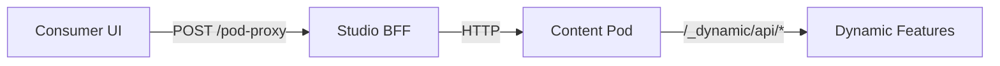

## Overview

roadbeat Studio includes a built-in **consumer experience** — a set of content discovery features that let Studio users explore content from the broader roadbeat network. These features are powered by the `@roadbeat/consumer` Angular library and backed by 14 NestJS backend-for-frontend (BFF) modules.

The consumer features appear in the **DISCOVER** section of the Studio sidebar, above the content management area.

<Callout kind="info" collapsed="false">
  The same `@roadbeat/consumer` library is shared between Studio and the standalone Web Client. In Studio, it's mounted at `/consumer/*`; in the Web Client, it's the primary experience.&#x20;
</Callout>

A few options exist only in the **standalone Web Client** because they depend on its own API or account model — keeping follows on the device only, the recovery code, browser push, and password-confirmed account deletion. They are marked as such below; in Studio those controls are hidden.

## Features

<Columns cols="2">
  <Card title="Compass" href="#compass" icon="compass" horizontal="false">
    Goal portfolio management with categories, templates, time horizons, and progress check-ins.
  </Card>

  <Card title="Discover" href="#discover" icon="search" horizontal="false">
    Federated search across Discovery Nodes with facets, goal tabs, calendar view, and transparency drawer.
  </Card>

  <Card title="Publishers" href="#publishers" icon="users" horizontal="false">
    Searchable publisher directory with trust badges, profiles, and follow system.
  </Card>

  <Card title="Bookmarks" href="#bookmarks" icon="bookmark" horizontal="false">
    Save and organize content into collections with a manual order, drag-to-reorder and optimistic updates.
  </Card>

  <Card title="Notifications" href="#notifications" icon="bell" horizontal="false">
    Notification center with filtering, archiving, preferences, and 5-minute polling.
  </Card>

  <Card title="Content Detail" href="#content-detail" icon="file-text" horizontal="false">
    Rich teaser views for 6+ content types with type-specific sections.
  </Card>
</Columns>

## Context Directory Integration

Consumer features require a **Context Directory** account. Studio automatically provisions a CD account for each user on first access to any consumer feature.

The account linking is managed via:

```bash
# Check CD account link status
GET /api/v1/consumer/account/status

# Manually trigger CD account linking
POST /api/v1/consumer/account/link

# Remove CD account link
DELETE /api/v1/consumer/account/link
```

Configure the Context Directory URL and its service key in `.env`:

```bash
CONTEXT_DIRECTORY_URL=http://localhost:3100
# Must equal the Context Directory's CD_SERVICE_KEY
CONTEXT_DIRECTORY_SERVICE_KEY=change-me
```

<Callout kind="alert" collapsed="false">
  Studio links accounts through the Context Directory's `POST /auth/register-or-link`, which returns tokens for an existing account. The Context Directory therefore only accepts that call with a shared `X-Service-Key` header, and Studio sends `CONTEXT_DIRECTORY_SERVICE_KEY` as that key. **Set it in production** to the same value as the Context Directory's `CD_SERVICE_KEY` — there is no production default, and without it account linking fails. Outside production the development key `roadbeat-dev-cd-service-key` is used.
</Callout>

## Language

The consumer screens follow the **Studio interface language** (all 24 EU locales) — when a user switches Studio to German, Compass, Discover, Bookmarks, Publishers, Notifications, Settings, Help and About switch with it. See [Interface Language](/guides/interface-language).

Data that comes from other services follows the same language. The library sends the UI language as `Accept-Language` on every consumer API call, and the BFF answers in it, falling back to English where no translation exists:

| What                                            | Source of the translation              |
| ----------------------------------------------- | -------------------------------------- |
| Teaser titles and descriptions                  | Multilingual teaser texts on the Discovery Node |
| Goal texts, goal tree, category and subcategory names | Context Directory goal catalog (24 languages) |
| Content type names                              | Schema Registry i18n files             |
| Filter headings and filter values (e.g. "Event type: Exhibition") | Schema Registry form schemas and i18n files |
| Country and region names                        | Context Directory geo i18n files       |
| Publisher "About" text                          | The publisher's own description        |

```bash
# Content type names in the request language: { "event": "Veranstaltung", ... }
GET /api/v1/consumer/content-types/names

# Filter labels for the keys on screen (max 200): field:value, value, @field (heading)
GET /api/v1/consumer/content-types/value-labels?keys=event_type:exhibition,culture,@event_type

# Content types and categories from the Schema Registry, names in the request language
GET /api/v1/consumer/content-types
GET /api/v1/consumer/content-types/categories

# Region names of one country in one language: { "regions": { "DE-BY": "Bayern", ... } }
GET /api/v1/consumer/geo/regions/:countryCode/i18n/:locale
```

Content type names and filter labels are cached for one hour per language. When the Schema Registry cannot be reached, these endpoints answer with an empty map or list (not cached) and the UI falls back to the humanized type slug.

## Compass

The **Compass** is the goal management center. Users define personal goals across time horizons, and the system matches content to those goals.

### Goal Management

```bash
# Get user's goal portfolio
GET /api/v1/consumer/goals

# Create a single goal
POST /api/v1/consumer/goals
{ "templateId": "...", "categoryId": "...", "subcategoryId": "...",
  "name": "...", "parameters": {}, "timeHorizon": "year" }

# Create multiple goals at once
POST /api/v1/consumer/goals/bulk
{ "goals": [{ "templateId": "...", "name": "...", "timeHorizon": "month", ... }] }

# Update a goal
PATCH /api/v1/consumer/goals/:goalId
{ "name": "...", "timeHorizon": "year" }

# Delete a goal
DELETE /api/v1/consumer/goals/:goalId

# Progress check-in
POST /api/v1/consumer/goals/:goalId/progress
{ "currentValue": 3, "targetValue": 10, "unit": "books" }
```

Every goal returned by these endpoints carries its resolved `contentQueries`, a `status` (`active`, `paused`, `completed`, `abandoned`) and the fields the Compass groups by:

| Field           | Description                                                                 |
| --------------- | --------------------------------------------------------------------------- |
| `subcategoryId` | Subcategory (filterset) the goal was created from                           |
| `groupId`       | Category of the goal tree the goal belongs to (missing for custom goals)    |
| `groupName`     | Name of that category, in the request language                              |
| `groupPosition` | Sort position of the category (tree order, then its place in the tree)      |
| `progress`      | Last check-in `{ currentValue, targetValue?, unit? }`, or `null` when never set |

### Goal Progress

Progress is tracked with **manual check-ins**. `POST /consumer/goals/:goalId/progress` forwards the values to the Context Directory, which marks the goal `completed` once `currentValue` reaches `targetValue`. `currentValue` must be 0 or more, `targetValue` at least 1 (it can be set once and changed later), and `unit` is a free label of up to 40 characters. The response is the updated goal.

### Goal Browsing & Search

```bash
# Get goal tree categories (e.g., personal, business)
GET /api/v1/consumer/goals/categories

# Get categories with subcategories for a goal tree
GET /api/v1/consumer/goals/trees/:treeId/categories

# Get individual goals for a subcategory
GET /api/v1/consumer/goals/subcategories/:subcategoryId

# Search goals (MeiliSearch-powered)
GET /api/v1/consumer/goals/search?q=mentor&treeId=personal
```

Tree, category and subcategory names, the goal texts of a subcategory and goal search hits are returned in the request language. A translated goal text is only used when its `{{placeholders}}` match the English text, so parameters always fill in. New goals are stored with the text the user saw; existing goals keep their names.

### Goal Structure

Goals are organized hierarchically:

- **Goal Tree** — e.g., Personal, Business, Publisher, Private Group

- **Category** — e.g., Career & Professional, Learning & Knowledge

- **Subcategory** — e.g., Career Networking, Language Learning

- **Goal** — e.g., "Find mentors in " with typed parameters

- **Time Horizon** — Life, Year, Month, Week, Day

### Compass Views

Goals are grouped by the **category of their goal tree** (e.g. 📚 Learning & Knowledge, 💼 Career & Professional, 🏃 Health & Wellness), using the `groupId` / `groupName` / `groupPosition` fields the API adds to each goal. Groups follow the tree order and carry an icon per category. Custom goals stay in their goal tree's group; goals with neither a category nor a tree are collected under **Other goals**.

The Compass page adapts its layout based on the selected time horizon filter:

- **"All" selected** — displays one card per goal category in a grid, each showing its goal count. Click a card to drill into that category.

- **Specific horizon selected** (Life, Year, Month, Week, Day) — switches to a flat goal list grouped by category name. Each group shows a category heading followed by goal cards with parameters and horizon badges. Only categories with matching goals are shown.

- **Goal detail** — opening a goal shows its parameters and a live **content preview**: "Matching items: n", the top three matches (they open in the [Content Reader](#content-reader)), and **View all matching content**, which opens Discover filtered to that goal (`discover?goal=<goalId>`).

Category and goal views have their own addresses — `/consumer/compass/:categoryId` and `/consumer/compass/:categoryId/:goalId` — so browser back/forward and shared links work. Each view has a single back link to the level above.

### Goal Reordering

Goals can be reordered via **drag-and-drop** (Angular CDK). Users grab a goal card and drag it to a new position within the list. The new sort order is persisted automatically via the API.

The time horizon filter is also available inside the **category detail view** — when viewing a single category's goals, the same horizon tabs appear above the goal list, and the goal count in the header updates to reflect the filtered results.

<Callout kind="info" collapsed="false">
  Time horizons are stored in both abbreviated (`l`, `y`, `m`, `w`, `d`) and full (`life`, `year`, `month`, `week`, `day`) forms. The UI normalizes both formats automatically, so filtering works regardless of how the horizon was originally saved.
</Callout>

### Goal Editor Wizard

The goal editor is a 4-step wizard:

1. **Select goal tree** — choose a tree (Personal, Business, etc.); each tree shows a short hint in the UI language saying who it is for

2. **Browse & multi-select** — expandable tree or search with checkbox multi-selection

3. **Customize goals** — scrollable list of selected goals with inline parameter inputs (text fields, searchable dropdowns) and per-goal time horizon selection

4. **Confirm** — review goals with the ability to remove individual goals before saving

The editor is a modal dialog: it is announced to screen readers, **Escape** closes it, and focus returns to the button that opened it.

Goals with parameterized text templates (e.g., `"Visit national parks in {{country}}"`) render inline input fields within the sentence. Parameters may include suggestions or options for searchable dropdowns. Time horizon is intelligently preselected from the goal's `time_context` metadata when a single value exists.

#### Editing Existing Goals

When editing an existing goal, the editor opens directly at step 3. For goals with parameters, the **standardized goal text** is reconstructed with inline variable inputs pre-filled with the current parameter values — the same UI as the add flow. The full resolved title is shown as an editable text field below the template line. Changing a variable automatically updates the full title. Custom goals (without parameters) show only the title input.

## Discover

The **Discover** page provides federated search across all configured Discovery Nodes.

### Search API

```bash
# Federated search
POST /api/v1/consumer/discover/search
{
  "query": "climate policy",
  "contentType": "news",
  "filters": { "location.country": "DE" },
  "page": 1,
  "limit": 20
}

# Goal-based search
POST /api/v1/consumer/discover/by-goal
{
  "goalId": "goal-uuid",
  "query": "marathon",
  "sort": "date",
  "sortOrder": "desc",
  "page": 1,
  "limit": 20
}

# Autocomplete suggestions
GET /api/v1/consumer/discover/suggestions?q=clim

# Available Discovery Nodes and their status
GET /api/v1/consumer/discover/nodes

# Facets for a content type
GET /api/v1/consumer/discover/facets/:contentType
```

`search` and `by-goal` both accept `sort` (`relevance`, `date`, `title`) and `sortOrder` (`asc`, `desc`); `limit` is 1–100. In a goal search:

- **`query`** narrows the goal feed to hits that match the text *and* one of the goal's content queries.
- **`sort` / `sortOrder`** are applied by the Discovery Node, and results merged from several nodes keep that order. Both are ignored in random mode.
- **`matchedGoalIds`** on each hit names the goals whose content queries matched it — the server-side answer to "why am I seeing this?". It is filled when the content queries in the request carry a `goal_id` (the Discovery Node names each query `goal:<goal_id>:cq:<n>` and reports the names that matched).

Suggestions come from the Discovery Node's `GET /api/v1/search/suggestions`. Facets are the aggregations of a search restricted to the content type (global facets plus the type's own fields, with multilingual labels) — the Discovery Node has no separate facet-definition endpoint.

<Callout kind="info" collapsed="false">
  Search responses only include the raw Discovery Node requests (`_debug`) when `DISCOVER_DEBUG=true` is set. Use it in development to inspect the queries; leave it off in production.
</Callout>

### Frontend Features

- **Facet sidebar** — dynamic filters (checkboxes, date ranges, geo distance, toggles). Filter headings and values are shown in the UI language.

- **Filters drawer on small screens** — below 1024 px the sidebar is replaced by a **Filters** button showing the number of active filters. It opens a slide-over drawer with the same filters (enum pills become standard checkboxes there); **Show results (n)**, the backdrop or Escape closes it.

- **Only from my country** — when **Share location** is on in [Discover Settings](#discover-settings) and the profile has a country, this filter limits results to teasers for that country (sent to the Discovery Node as `geographic.country_codes`). It appears as a "My country: …" pill while active.

- **Goal group tabs** — two-level tab navigation: the first row shows the goal categories of the [Compass](#compass-views) plus an "All Goals" tab; selecting a category reveals a second row of individual goal tabs within that category. Tab order follows the user's Compass sort order. Selecting a goal tab triggers a goal-based search; the search box and sort controls work inside goal feeds too.

- **View modes** — 8 modes organized in grouped toggle: Activity Feed (social-media timeline with big images), Compact List, Large List (detailed rows with larger thumbnails), Compact Tiles (4 per row), Large Tiles (3 per row with more info), Calendar, Map (interactive Leaflet/OpenStreetMap with marker clustering), 3D Globe (interactive Mapbox globe with custom markers)

- **Sort controls** — by relevance, date, or title. Each field starts in its natural direction (newest first, title A→Z); Relevance has no direction toggle.

- **"Why am I seeing this?"** — transparency drawer explaining content matching and goal relevance

- **Active filter pills** — dismissible badges showing current filters

- **Links into Discover** — `discover?goal=<goalId>` opens the feed of one goal (from the Compass goal detail), `discover?publisher=<id>` filters by a publisher (from a publisher profile's **View all content**).

The Calendar, Map and 3D Globe views show one result set without pagination, so they load up to 100 results at once; the paged views go back to normal pages.

### Map View

The **Map** view mode renders content with geographic coordinates on an interactive map using [Leaflet](https://leafletjs.com/) with OpenStreetMap tiles.

- **Marker clustering** — nearby markers are grouped into cluster badges that show the count and expand on zoom or click. Cluster sizes: small (blue, \<10), medium (amber, 10–99), large (red, 100+).

- **Custom icon markers** — each content type is represented by a 36px white circle marker with a color-coded border and a Lucide SVG icon inside (e.g., calendar for events, briefcase for jobs, pen for blog posts). Colors are grouped by content type category (blue for news/publications, purple for events, green for jobs, orange for food, etc.).

- **Popup cards** — clicking a marker opens a vertical popup card matching the teaser grid card design: full-width hero image, content type badge with inline Lucide icon, publisher name, title (2-line clamp), description (2-line clamp), and a footer with publication date and info/bookmark action buttons.

- **Facet sidebar** — the map renders inside the content area alongside the facet sidebar, so all filters (content type, language, topic, publisher, date) remain accessible.

- **Auto-fit bounds** — the map zooms to fit all visible markers with padding.

- **Reactive** — markers update dynamically when filters, goal tabs, or search queries change.

<Callout kind="info" collapsed="false">
  Only teasers with `location.lat` and `location.lon` appear on the map. The badge in the top-right corner shows the count of geo-tagged items out of the total result set.
</Callout>

The backend extracts geographic coordinates from the Discovery Node response at `geographic.locations[0].coordinates` and maps them to the `TeaserDto.location` field with `lat`, `lon`, and `name`.

### 3D Globe

The **3D Globe** view mode renders geo-tagged content on an interactive 3D globe using [Mapbox GL JS](https://docs.mapbox.com/mapbox-gl-js/) with the `globe` projection.

- **Mapbox-powered globe** — full 3D globe with atmosphere, stars, fog, and smooth rotation using `mapbox://styles/mapbox/streets-v12` for a colorful base map.

- **Custom Lucide icon markers** — each content type has a distinct marker: 36px colored circular pin with a white background, content-type-specific border color, and a Lucide SVG icon (e.g., Calendar for events, Newspaper for news, Ticket for festivals, Briefcase for jobs, ChefHat for recipes, Home for real estate, GraduationCap for courses, Package for products). Markers scale up on hover with a smooth transition.

- **Popup cards** — clicking a marker opens a compact card popup with:

  - Hero image (120px) with rounded top corners and a close button overlay

  - Content type badge with inline Lucide icon and publisher name

  - Bold title and truncated description

  - Footer with publication date and info/bookmark action buttons

- **Smart camera** — the globe automatically flies to the geographic center of all markers with an appropriate zoom level calculated from the coordinate span.

- **Optional spin** — globe auto-rotation is disabled by default but can be toggled on via the spin button. Rotation speed decreases at higher zoom levels and pauses during user interaction.

- **Navigation controls** — zoom and compass controls in the bottom-right corner.

<Callout kind="info" collapsed="false">
  The 3D Globe requires a Mapbox access token. Configure it in your `.env` file:

  ```bash
  MAPBOX_TOKEN=pk.your_mapbox_token_here
  ```

  The token is served via a public endpoint (`GET /consumer/discover/mapbox-config`) so the frontend can initialize the map without authentication. If no token is configured, the globe view is automatically hidden from the view mode toggle.
</Callout>

#### Content Type Marker Colors

Both the 2D map and 3D globe use consistent color-coded circle markers with Lucide SVG icons. Colors are grouped by content type category:

| Category                  | Color              | Example Icons                                    |
| ------------------------- | ------------------ | ------------------------------------------------ |
| **News & Publications**   | Blue (`#3b82f6`)   | Newspaper, Megaphone, PenLine, FileText          |
| **Events & Activities**   | Purple (`#8b5cf6`) | Calendar, Target, Users, Monitor, Ticket         |
| **Employment**            | Green (`#22c55e`)  | Briefcase, GraduationCap, Wrench, HeartHandshake |
| **Food & Dining**         | Orange (`#f97316`) | ChefHat, Utensils                                |
| **People & Profiles**     | Sky (`#0ea5e9`)    | Building2, User, UserCheck                       |
| **Commerce & Listings**   | Yellow (`#eab308`) | Package, ClipboardList, Gem                      |
| **Education & Learning**  | Cyan (`#06b6d4`)   | BookOpen, ListChecks, GraduationCap              |
| **Media & Entertainment** | Pink (`#ec4899`)   | Music, Mic, Camera, Palette                      |
| **Knowledge & Reference** | Indigo (`#6366f1`) | Microscope, FlaskConical, FolderKanban           |
| **Default**               | Indigo (`#6366f1`) | FileText                                         |

### Calendar View

The **Calendar** view mode displays content on a month grid, organized by the teaser's **event date**, or its publication date when it has none. Days are computed in the viewer's local time zone, and date-only values stay on their day. Each day cell shows a preview of scheduled events, news, jobs, and other date-based content.

#### Month View

- **6-row grid** — Monday-start weeks filling the full viewport height via `calc(100vh - offset)` with `grid-rows-6` for evenly distributed rows.

- **Dynamic teaser count** — a `ResizeObserver` measures actual cell height and calculates how many teasers fit per day. On 4K monitors, 5+ items may be visible; on smaller screens, 1–2.

- **Color-coded entries** — each content type has a distinct color: purple for events, blue for news, green for jobs, amber for courses.

- **"+N more" drill-down** — when a day has more teasers than the cell can display, a clickable "+N more" link switches to the **week view** for that day's week.

- **Month navigation** — previous/next month arrows with a header showing the current month and year.

#### Week View

Clicking "+N more" on any day opens a week view for that Monday–Sunday range:

- **Full event list** — all teasers for each day are shown (no truncation), with publisher names displayed below each title.

- **Taller cells** — each day column fills the remaining viewport height with a scrollable teaser list.

- **Event count** — a small badge in each day header shows the number of events.

- **Today highlight** — the current day gets a ring highlight for quick orientation.

- **Week navigation** — previous/next week arrows; the header shows the date range (e.g., "10 Mar – 16 Mar 2026").

- **Back to month** — a "Month" button in the header returns to the monthly grid.

<Callout kind="tip" collapsed="false">
  The week view is especially useful for days with many events — like conference weeks or festival periods — where the month view's limited cell height would hide most content behind "+N more".
</Callout>

### Transparency Drawer

The **"Why am I seeing this?"** drawer is a slide-over panel that explains why a specific piece of content was recommended. It opens when the user taps the info icon on any content card.

The drawer displays:

- **Teaser summary** — title, content type, publisher, and thumbnail

- **Goal match indicator** — a dynamic status box:

  - 🟢 **Goal match** (green) — when one or more user goals matched the content

  - 🔵 **Content match** (blue) — when content was found via search criteria without a specific goal match, or when the user has no goals set up

- **Relevance score** — visual progress bar showing the search relevance percentage

- **Matched goals** — list of user goals that relate to this content, displayed as green badges with checkmark icons, showing goal name and category. If no goals matched, an informative message is shown instead:

  - *"No specific goal matched this content"* — when the user has goals but none overlap

  - *"No goals set up yet"* — when the user hasn't created any goals on the Compass page

- **Matching criteria** — badges showing content classification tags (e.g., "technology", "environment")

- **Adjust your results** — action links:

  - **Edit your goals** — navigates to the Compass page (`/consumer/compass`)

  - **Adjust location settings** — navigates to Discover Settings (`/consumer/settings`)

  - **Hide content from this publisher** — mutes the publisher, hiding all their content from Discover (see [Muting](#muting))

#### Goal Matching Logic

The drawer determines matched goals using a three-tier strategy:

<Steps>
  <Step title="Direct match" title-type="p">
    If the content was found via a **goal-based search** (`POST /discover/by-goal`), the teaser carries the originating `goalId`. This provides a guaranteed match.
  </Step>

  <Step title="Active goal tab" title-type="p">
    If the user has a **goal tab selected** in the Discover view, that goal is used as the match context.
  </Step>

  <Step title="Fuzzy matching" title-type="p">
    As a fallback, the system compares the content's **badges and content type** against the user's goal names and categories using partial substring matching. For example, a teaser with the badge "technology" would match a goal named "Follow developments in technology".
  </Step>
</Steps>

Clients that send goal-tagged content queries to `POST /discover/by-goal` (the mobile app does) get an exact answer without guessing: each hit's `matchedGoalIds` lists the goals whose queries matched it (see [Search API](#search-api)).

The drawer, like the bookmark popover and the goal editor, is a modal dialog: Escape closes it and focus returns to the card that opened it.

<Callout kind="tip" collapsed="false">
  Setting up goals on the Compass page significantly improves the transparency drawer experience — it enables the system to show exactly which goals led to each content recommendation.
</Callout>

## Publishers

Browse and follow publishers across the roadbeat network.

```bash
# Search publishers
GET /api/v1/consumer/publishers?q=news&filter=verified&page=1&limit=20

# Get publisher detail
GET /api/v1/consumer/publishers/:id

# Get publisher's content
GET /api/v1/consumer/publishers/:id/content
```

The API returns only the fields a reader needs — the publisher's contact e-mail and contact name, public key and rate limits stay on the Discovery Node. A publisher record carries:

| Field               | Description                                                                 |
| ------------------- | --------------------------------------------------------------------------- |
| `verificationLevel` | Trust level: `unverified`, `domain`, `organization` or `trusted` (see [Trust Badges](#trust-badges)) |
| `teaserCount`       | Teasers indexed for the publisher, counted in the search index              |
| `itemsLast90Days`   | Items published in the last 90 days                                         |
| `description`       | The "About" text, in the request language where the publisher provides it   |
| `contentTypes`      | Content types the publisher publishes                                       |

The publisher profile shows the publishing frequency derived from `itemsLast90Days` ("≈ 3 per week", "≈ 2 per month", "Less than monthly" or "None in 90 days"), the recent content from the search index, and **View all content**, which opens Discover filtered to the publisher.

<Callout kind="tip" collapsed="false">
  For a Studio organization, the "About" text is its **organization description** (Settings → Organization). When the description changes, Studio sends it to the organization's enabled Discovery Nodes in the organization's default language. See [Publishing](/guides/publishing).
</Callout>

### Following

```bash
# Get followed publishers
GET /api/v1/consumer/follows

# Follow a publisher
POST /api/v1/consumer/follows/:publisherId

# Unfollow a publisher
DELETE /api/v1/consumer/follows/:publisherId

# Sync full follow list
PUT /api/v1/consumer/follows
{ "publisherIds": ["id-1", "id-2"] }
```

#### Where follows are kept

In Studio, follows and muted publishers belong to the **account**: they are kept in the browser for instant use and synced to the server, so they reach every device and the mobile app.

The **standalone Web Client** additionally lets users choose under **Settings → Privacy**:

- **In my roadbeat account** (default) — on all devices and in the app.
- **Only on this device** — nothing is stored on the server; other devices and the app don't see them.

Switching moves the data: to the device, the lists are loaded from the account and the server copy is emptied; back to the account, the browser's lists are uploaded.

### Muting

Muting is the inverse of following — it permanently hides all content from a specific publisher across all Discover views (goal-driven, search, "all", "random").

```bash
# Get muted publishers
GET /api/v1/consumer/follows/muted

# Sync full muted list
PUT /api/v1/consumer/follows/muted
{ "publisherIds": ["id-1", "id-2"] }

# Mute a publisher
POST /api/v1/consumer/follows/muted/:publisherId

# Unmute a publisher
DELETE /api/v1/consumer/follows/muted/:publisherId
```

<Callout kind="info" collapsed="false">
  Following and muting are **mutually exclusive** — muting a followed publisher automatically unfollows them, and following a muted publisher automatically unmutes them.
</Callout>

#### Mute Entry Points

- **Publisher card** — kebab menu (⋮) → "Mute" action
- **Publisher detail page** — Mute button next to Follow button
- **"Why am I seeing this?" drawer** — "Hide content from this publisher" link
- **Publisher list → Muted tab** — view and manage all muted publishers

#### How Muting Works

<Steps>
  <Step title="User mutes a publisher" icon="volume-x" title-type="p">
    The publisher ID is added to the local muted set and persisted to `localStorage` under key `rb_muted_publishers`. If the publisher was followed, it is automatically unfollowed.
  </Step>

  <Step title="Debounced server sync" icon="cloud" title-type="p">
    After a 5-second debounce, the full muted list is synced to the Studio database (`cd_account_links.muted_publisher_ids` column) via `PUT /follows/muted`.
  </Step>

  <Step title="Content exclusion" icon="filter" title-type="p">
    On every Discover search, `excludePublisherIds` is injected into the query filters. The backend translates this to a `publisher.id_exclude` filter on Discovery Nodes, ensuring muted content never appears in results.
  </Step>
</Steps>

<Callout kind="tip" collapsed="false">
  Muting does not remove existing bookmarks from muted publishers — users retain access to previously saved content.
</Callout>

The `localStorage` copies belong to the signed-in account — see [Data on shared browsers](#data-on-shared-browsers).

### Trust Badges

Publishers have 4 trust levels displayed as colored badges:

| Level            | Badge | Meaning                        |
| ---------------- | ----- | ------------------------------ |
| **Unverified**   | Gray  | No verification                |
| **Domain**       | Blue  | Domain ownership verified      |
| **Organization** | Green | Organization identity verified |
| **Trusted**      | Gold  | Full editorial verification    |

## Bookmarks

Save content and organize into collections.

```bash
# Get bookmarks (paginated, optionally one collection)
GET /api/v1/consumer/bookmarks?collectionId=uuid&sort=newest&page=1&limit=20

# Index of all bookmarks: teaser IDs + their collections, no teaser data
GET /api/v1/consumer/bookmarks/index

# Add bookmark
POST /api/v1/consumer/bookmarks
{ "teaserId": "teaser-uuid" }

# Remove bookmark
DELETE /api/v1/consumer/bookmarks/:teaserId
```

`sort` is `newest` (default), `oldest` or `custom`. `custom` returns a collection in its manual order; without a `collectionId` it falls back to newest first.

There is no per-teaser "is this bookmarked?" endpoint. Load `GET /api/v1/consumer/bookmarks/index` once and resolve the bookmarked state client-side — the index covers **all** bookmarks, whereas the paged list only holds what is on screen. That is also what keeps the follow/bookmark graph off the server's request log.

### Collections

```bash
# List collections with item counts
GET /api/v1/consumer/bookmarks/collections

# Create collection
POST /api/v1/consumer/bookmarks/collections
{ "name": "Research", "icon": "book" }

# Rename / change icon
PUT /api/v1/consumer/bookmarks/collections/:id
{ "name": "Climate Research" }

# Delete collection (its bookmarks stay)
DELETE /api/v1/consumer/bookmarks/collections/:id

# Add item to collection
POST /api/v1/consumer/bookmarks/collections/:id/items
{ "teaserId": "teaser-uuid" }

# Remove item from collection
DELETE /api/v1/consumer/bookmarks/collections/:id/items/:teaserId

# Save the manual order of the items on one page
PUT /api/v1/consumer/bookmarks/collections/:id/reorder
{ "teaserIds": ["teaser-3", "teaser-1", "teaser-2"] }
```

Inside a collection the Bookmarks page sorts by **My order** by default. New items are added at the top; items can be dragged, or moved with **Move up / Move down** buttons for keyboard and touch users (focus stays on the moved item). A reorder only rearranges the submitted items among their own positions, so reordering one page does not disturb the order of the others.

Each collection has its own address (`/consumer/bookmarks/:collectionId`). The open collection can be renamed (name and icon) or deleted after a confirmation — deleting a collection never deletes the bookmarks in it.

## Notifications

```bash
# Get notifications (paginated, filterable by type)
GET /api/v1/consumer/notifications?type=content&page=1&limit=20

# Get unread count
GET /api/v1/consumer/notifications/unread-count

# Mark as read
PUT /api/v1/consumer/notifications/:id/read

# Mark all as read
PUT /api/v1/consumer/notifications/read-all

# Archive / restore a notification
PUT /api/v1/consumer/notifications/:id/archive
PUT /api/v1/consumer/notifications/:id/unarchive

# Browser push status (always { "available": false } in Studio)
GET /api/v1/consumer/notifications/push

# Get/update notification preferences
GET /api/v1/consumer/notifications/preferences
PUT /api/v1/consumer/notifications/preferences
```

- **Archive** — each notification row has an archive button. Archiving is a soft delete: the notification disappears from the list and the unread count, and `unarchive` brings it back. Users can only archive their own notifications.
- **Translated texts** — notifications the server creates (welcome, password changed, data export ready, account deletion scheduled or cancelled, …) carry a `titleKey` / `bodyKey` with parameters in their `data`. The UI shows them in the current UI language and falls back to the stored English text for keys it does not know.
- **Opening a notification** — clicking an entry in the dropdown opens its `actionUrl`.
- **Browser push** — push notifications belong to the standalone Web Client's API. Studio answers `GET /consumer/notifications/push` with `available: false`, so the library shows neither the push switch nor the push offer there. In the Web Client, push is opt-in: it is offered once after the third sign-in (never as a modal, and not in a browser that blocks notifications), and the switch in Settings subscribes or unsubscribes the current browser.

## Content Reader

The **Content Reader** provides an integrated inline reading experience for content from Content Pods, replacing the previous behavior of opening external URLs in new tabs.

### Display Modes

| Mode              | Context                            | Behavior                                                             |
| ----------------- | ---------------------------------- | -------------------------------------------------------------------- |
| **Split pane**    | 4K / ultrawide (≥2560px)           | Side-by-side: left 50% Discover list, right 50% reader pane          |
| **Modal overlay** | Regular desktop, tablet, mobile    | Full-screen modal with focus trap, Escape to close, backdrop dismiss |
| **External tab**  | Self-hosted content (`isExternal`) | Opens in new browser tab with external-link badge on cards           |

Clicking a card title in any view opens the reader (or, for external content, a new tab) — the app is never left in the same tab.

### Reader Links

While the reader is open, the address bar shows a link to the item, and these links open the reader directly when loaded or shared:

| Route                                              | Opens                                   |
| -------------------------------------------------- | --------------------------------------- |
| `/consumer/discover/read/:contentType/:slug`       | Discover with the item in the reader    |
| `/consumer/bookmarks/read/:contentType/:id`        | Bookmarks with the item in the reader   |

### Content Reader Features

- **Hero image** with alt text, resolved against the pod base URL

- **Article body** rendered as sanitized HTML with relative asset URLs rewritten to absolute pod URLs

- **Publisher metadata** — name, publication date, reading time, word count

- **Content signature badge** — Verified (green), Signature invalid (red), or Unverified (gray)

- **Categories, tags, and language badges**

- **Image gallery** with resolved thumbnails and captions

- **Loading skeleton** — realistic full-layout skeleton matching the content structure

- **Error states** — 4 context-specific screens: pod unreachable, content not found, signature invalid, and generic error — each with Retry and Close actions

The reader understands both the reader content shape (headline, article body, media, dates) and the shape the Content Pod generator writes (`{ data: { title, description, hero_image, … } }`), so full pod content is shown either way. Multilingual texts are shown in the UI language.

### Content Reader API

```bash
# Fetch full content for the reader
GET /api/v1/consumer/discover/content/:contentType/:slug

# Proxy dynamic pod interactions
POST /api/v1/consumer/discover/pod-proxy
{
  "podBaseUrl": "https://pod.example.com",
  "endpoint": "/_dynamic/api/reactions.php",
  "method": "GET",
  "params": { "content_id": "c_001" }
}
```

### Modal Accessibility

The content reader modal includes:

- **ARIA dialog** attributes (`role="dialog"`, `aria-modal="true"`)

- **Focus trap** — Tab cycling within the modal

- **Focus restoration** — returns focus to the previously focused element on close

- **Keyboard support** — Escape to close

- **Reduced motion** — animations disabled when `prefers-reduced-motion` is set

## Dynamic Pod Features

When content is loaded from a **dynamic Content Pod** (one that has `_roadbeat/config.json` with enabled features), the Content Reader displays interactive sections below the article body.

<Callout kind="info" collapsed="false">
  Dynamic sections are **capability-driven** — they only appear when the pod's configuration explicitly enables them. The pod capabilities are probed automatically when content is loaded.
</Callout>

### Reactions

Emoji reaction buttons (👍❤️🔥👏🤔) displayed below the article. Users can toggle reactions with optimistic UI updates. Pods can specify custom reaction types via their configuration.

### Comments

Threaded comment display with:

- Recursive rendering up to a configurable `maxDepth` (default: 3)

- Comment submission form with name, email, and content fields

- Reply-to threading with visual indentation

- Loading skeletons during fetch

- Empty state with call-to-action

### Newsletter

Inline subscription form that appears when the pod advertises newsletter capability:

- Email input with validation

- Loading spinner during submission

- Success confirmation message

- Publisher name personalization in the header

### Pod-Proxy Architecture

All dynamic pod interactions are proxied through the Studio BFF to avoid CORS issues and provide a consistent API surface:



The BFF endpoint accepts the pod base URL, target endpoint, HTTP method, and parameters, then forwards the request to the pod's dynamic API.

## Tip System

The **Tip System** lets users compensate content creators through a budget-based tipping mechanism. Tips are tracked locally in `localStorage` and represent appreciation for quality content.

<Callout kind="info" collapsed="false">
  Tipping starts only after the user has **set up a content budget** — saved a monthly budget greater than 0 under Settings → Tip Budget. Until then the reader footer shows a **Set up content budget** button (it closes the reader and jumps to the Tip Budget section of the settings) instead of the multiplier, no auto-tip countdown runs, and no tip is recorded.
</Callout>

### How It Works

<Steps>
  <Step title="Content loads in reader" icon="book-open" title-type="p">
    When content finishes loading, the auto-tip countdown starts (if a budget is set up and auto-tip is enabled).
  </Step>

  <Step title="Countdown runs" icon="clock" title-type="p">
    A configurable timer (default 30s) counts down in the footer. The user can manually tip at any time by selecting a multiplier and clicking confirm.
  </Step>

  <Step title="Tip recorded" icon="check-circle" title-type="p">
    When the countdown reaches zero (or the user clicks confirm), the tip is recorded to localStorage with the teaser ID, publisher, multiplier, and timestamp.
  </Step>

  <Step title="Budget tracked" icon="wallet" title-type="p">
    Monthly spending is computed from tip history. The budget progress bar updates in real-time, and tips are blocked when the monthly budget is exhausted.
  </Step>
</Steps>

### Tip Multiplier

The footer displays a **1x–5x multiplier selector** with pill buttons. The selected multiplier determines how many budget units are consumed per tip.

### Budget Configuration

Users configure their tip budget in **Discover Settings → Tip Budget**. The defaults below pre-fill the form; they take effect once the budget is saved:

| Setting                 | Range   | Default | Description                              |
| ----------------------- | ------- | ------- | ---------------------------------------- |
| **Monthly budget**      | 10–500  | 100     | Maximum tip units per month              |
| **Auto-tip**            | on/off  | on      | Enable automatic tipping after reading   |
| **Auto-tip delay**      | 10–120s | 30s     | Seconds of reading before auto-tip fires |
| **Auto-tip multiplier** | 1x–5x   | 1x      | Default multiplier for automatic tips    |

### Tip Stats

The settings page displays:

- **Spent this month** — total tip units consumed in the current calendar month

- **Total tips given** — lifetime tip count

- **Budget progress bar** — green (>50%), yellow (20–50%), red (\<20%)

<Callout kind="tip" collapsed="false">
  Tip data is stored in `localStorage` under `rb_tip_history` (last 500 records) and `rb_tip_budget` (configuration), bound to the signed-in account (see [Data on shared browsers](#data-on-shared-browsers)). Future versions will sync tip data to the Context Directory for cross-device persistence.
</Callout>

## Content Detail

Rich teaser detail views with content-type-specific sections:

```bash
# Get teaser detail
GET /api/v1/consumer/discover/teaser/:contentType/:slug

# Get related content
POST /api/v1/consumer/discover/related
{ "contentType": "news", "categories": ["politics"], "tags": ["climate"], "excludeId": "teaser-uuid" }
```

The teaser detail returns a mapped `TeaserDetail` (title, publisher, canonical URL, type-specific fields) with texts in the request language. Related content is searched on the Discovery Nodes by content type and categories (`classification.categories`), topped up with other items of the same type when too few match, and returned without the item named in `excludeId` (default `limit`: 6). `tags` and `publisherId` are accepted but do not narrow the search.

Content-type-specific sections include:

| Content Type    | Special Fields                               |
| --------------- | -------------------------------------------- |
| **News**        | Publication date, source, reading time       |
| **Events**      | Date/time, venue, ticket price, registration |
| **Jobs**        | Company, salary, employment type, deadline   |
| **Recipes**     | Prep/cook time, servings, difficulty         |
| **Real Estate** | Price, rooms, area, address                  |
| **Courses**     | Duration, skill level, format                |

## Mobile Sync

The **Get the app** page (`/consumer/get-app`) transfers a user's goals, follows, bookmarks, collections and preferences to the mobile app — by scanning a QR code or by typing a short pairing code.

```bash
# Generate sync package
GET /api/v1/consumer/sync/package

# Create single-use sync token (returns token, code, expiresAt, syncUrl)
POST /api/v1/consumer/sync/token

# Get QR code data: a fresh token's deep link, its short code and expiry
GET /api/v1/consumer/sync/qr

# Redeem by token (public endpoint)
GET /api/v1/consumer/sync/token/:token

# Redeem by short pairing code (public endpoint, 5 attempts per minute)
GET /api/v1/consumer/sync/code/:code
```

How pairing works:

- **Deep link** — the QR code encodes `roadbeat://sync/<token>?studio=<PUBLIC_URL>`. Because the link names the Studio, a device without a Studio session knows where to redeem it. Set `PUBLIC_URL` to the address the app can reach.
- **Short code** — every token also gets an 8-character pairing code shown next to the QR as `XXXX-XXXX` (Crockford base32). Case, dashes, and the look-alikes I/L/O are forgiven when it is typed. Lookups are throttled to 5 per minute per client.
- **Single use, 10 minutes** — token and code expire after 10 minutes and are claimed atomically: the first redemption gets the package, every later one gets `404` (`SYNC_TOKEN_INVALID` / `SYNC_CODE_INVALID`). The page shows a live countdown and offers a new code once it has expired.
- **QR rendered in the browser** — the QR image is generated client-side, so the sync link never leaves the device for an external QR service.
- **What will be synced** — the counts on the page come from the sync package itself. Goals in the package carry their goal tree (`treeId`) so they can be imported elsewhere.

## Discover Settings

The **Discover Settings** page (`/consumer/settings`) is a unified settings experience that combines profile management and consumer preferences into a single page with 7 card sections.

<Callout kind="info" collapsed="false">
  Studio users have two identities: a **Studio account** (CMS admin login) and a **Discover profile** (identity on the roadbeat network). The Discover profile is automatically linked to the Studio account via the Context Directory. Users manage their Discover profile and preferences on this page, while Studio-level settings (organization, API keys, etc.) remain under System → Settings.
</Callout>

### Settings Sections

| Section                 | Description                                                                                                                         |
| ----------------------- | ----------------------------------------------------------------------------------------------------------------------------------- |
| **Discover Profile**    | Display name (editable), email (read-only, managed by Studio account), CD link status                                               |
| **Language & Region**   | Preferred locale (24 EU languages), country and region — both selects with names in the UI language                                 |
| **Privacy**             | Toggles for goal sync, follows sync, bookmarks sync, location sharing, analytics consent — all off until the user turns them on     |
| **Notifications**       | Goal digest frequency (daily/weekly/off), publisher updates, bookmark reminders, system announcements (browser push only where the host supports it — not in Studio) |
| **Content Preferences** | Enable/disable content types in Discover feed (news, events, jobs, courses, recipes, real estate, press releases)                   |
| **Tip Budget**          | Monthly budget slider (10–500), auto-tip toggle, delay slider (10–120s), auto-tip multiplier (1x–5x), spending stats, clear history |
| **Discovery Nodes**     | Select which Discovery Nodes to query, with online/offline status badges                                                            |
| **Security**            | Change password (current + new + confirm); a wrong current password is reported in the UI language                                  |

Privacy and content-type toggles are saved to the account (`GET`/`PUT /api/v1/consumer/user/preferences`) and survive a reload. **Share location** sends nothing on its own: it enables the Discover filter [Only from my country](#frontend-features), and only the country code is sent to Discovery Nodes, only while that filter is on.

In the **standalone Web Client** the page differs slightly: the Studio-account explainer and the three "sync … to the Context Directory" toggles are hidden (goals, follows and bookmarks live in the account there), Privacy offers the choice [where follows are kept](#where-follows-are-kept), and Security adds **Create new recovery code** — the Context Directory stores no e-mail address, so the recovery code is the only way to reset a forgotten password. It needs the current password and is shown once, with a copy button.

### Profile API

The profile endpoint returns Studio user data as the primary source, enriched with Context Directory data when available:

```bash
# Get user profile (composite: Studio + CD)
GET /api/v1/consumer/user

# Update profile
PUT /api/v1/consumer/user

# Change password
PUT /api/v1/consumer/user/password

# Get/update consumer preferences (locale, theme, privacy toggles, content types, nodes)
GET /api/v1/consumer/user/preferences
PUT /api/v1/consumer/user/preferences
```

### Notification Preferences API

```bash
# Get notification preferences (auto-creates defaults on first access)
GET /api/v1/consumer/notifications/preferences

# Update notification preferences
PUT /api/v1/consumer/notifications/preferences

# Get unread notification count
GET /api/v1/consumer/notifications/unread-count
```

### GDPR & Data

Users export their data and delete their account on **Profile → My Data** (`/consumer/profile/data`).

```bash
# GDPR data export
POST /api/v1/consumer/user/export
GET /api/v1/consumer/user/export/:token

# Account deletion (30-day grace period)
GET /api/v1/consumer/user/delete/status
POST /api/v1/consumer/user/delete
POST /api/v1/consumer/user/delete/cancel
```

**Data export** — `POST /export` collects profile, goals, follows, bookmarks, collections and preferences and returns a download link valid for **24 hours**. The download requires the same signed-in user who requested it; the UI fetches it through the authenticated client.

**Account deletion** works in two stages:

<Steps>
  <Step title="Request" icon="calendar-clock" title-type="p">
    `POST /delete` schedules the deletion 30 days ahead. The confirmation word is `DELETE` in every UI language. `GET /delete/status` returns `{ pending, deleteAt }`, so a pending deletion stays visible after a reload and can be cancelled with `POST /delete/cancel` until it runs.
  </Step>

  <Step title="Execution" icon="trash" title-type="p">
    An hourly job executes due requests. It first deletes the user's goals and follows in the Context Directory — if the Directory cannot be reached, the deletion is retried on the next run — and then erases the account: bookmarks and collections, consumer and notification preferences, data exports, sync tokens, the Context Directory link, notifications, sessions, passkeys and MFA secrets, and platform-admin rights. The Studio user is anonymized as "Deleted User"; content the user authored stays in the organization.
  </Step>
</Steps>

<Callout kind="alert" collapsed="false">
  The **last active admin** of an organization cannot delete their account. The request is refused immediately with `409 ACCOUNT_DELETE_LAST_ADMIN` — make another member an admin first.
</Callout>

In the standalone Web Client the Context Directory deletes the account itself and asks for the password; when `delete/status` reports `requiresPassword`, the page shows a password field.

### Database Schema

Consumer data that Studio keeps is stored in the Studio database (not the Context Directory):

- **`notifications`** — the Studio notification table, shared with CE notifications: `id`, `organization_id`, `user_id` (FK → users), `type`, `title`, `body`, `data` (JSONB, holds `actionUrl` and translation keys), `read_at`, `archived_at`, `created_at`. Every query is scoped by organization **and** user.

- **`consumer_notification_preferences`** — `id`, `user_id` (unique, FK → users), `goal_digest_frequency` (default: weekly), `publisher_updates`, `bookmark_reminders`, `system_announcements`, `browser_push` (default: off)

- **`user_preferences`** — locale, theme, the privacy toggles (all default `false`), enabled content types and Discovery Node URLs

- **`data_exports`**, **`account_deletions`** (with `executed_at`, `attempted_at`, `last_error`), **`sync_tokens`** (with the short pairing `code`)

## Data on Shared Browsers

The library keeps some data in the browser — copies of the bookmarked state and the follow and mute lists, plus data that exists only there (tips, tip budget, recent searches, and follows in "only on this device" mode). This data belongs to the **signed-in account**, so on a shared browser the next person never sees, or uploads into their own account, the previous person's follows, mutes or bookmarks:

- **On sign-out**, copies of server data are dropped and browser-only data is put away under the account, to be given back at its next sign-in. Studio reloads the page on logout so no account data stays in memory.
- **When another account signs in** after a session that ended without sign-out, the previous account's data is put away first.

Hosts embed this through the library's `beginLocalAccountSession()` (on sign-in or session restore) and `endLocalAccountSession()` (on sign-out).

## Configuration

| Variable                        | Default                  | Purpose                                                                 |
| ------------------------------- | ------------------------ | ----------------------------------------------------------------------- |
| `CONTEXT_DIRECTORY_URL`         | `http://localhost:3100`  | Context Directory for accounts, goals and geo data                      |
| `CONTEXT_DIRECTORY_SERVICE_KEY` | dev key outside production | Shared key for account linking; must equal the Directory's `CD_SERVICE_KEY` — **required in production** |
| `DISCOVERY_NODE_URLS`           | `http://localhost:3300`  | Comma-separated Discovery Nodes that Discover searches                  |
| `DISCOVER_DEBUG`                | `false`                  | Adds the raw Discovery Node requests (`_debug`) to search responses — development only |
| `MAPBOX_TOKEN`                  | —                        | Enables the 3D Globe view                                               |
| `PUBLIC_URL`                    | `http://localhost:<PORT>` | Studio address put into mobile sync links (`?studio=`)                  |

See [Configuration](/deployment/configuration) for all other settings.

## Shared Services

The `@roadbeat/consumer` library provides shared services used across all features:

| Service                     | Description                                                                   |
| --------------------------- | ----------------------------------------------------------------------------- |
| **ThemeService**            | Light/dark/system mode with `matchMedia` detection                            |
| **I18nService**             | 24 EU locales with lazy-loaded JSON and `{{param}}` interpolation; follows the host's UI language |
| **ContentTypeNamesService** | Content type names and filter labels in the UI language, loaded in batches for what is on screen |
| **SeoService**              | Dynamic meta/OG/Twitter Card tags, canonical URLs, JSON-LD                    |
| **FocusManagementService**  | Route-change focus, scroll-to-top, ARIA live announcements                    |
| **ConsumerPushService**     | Opt-in browser push, only where the host's API offers it                      |

The library also exports the `t` (translate) and `localDate` pipes and the `rbDialog` directive, which gives overlays dialog semantics: `role="dialog"`, an accessible name, focus moved into the panel and back to the trigger, and Escape to dismiss.

## Consumer Health

```bash
GET /api/v1/consumer/health
GET /api/v1/consumer/health/ready
GET /api/v1/consumer/health/live
```

