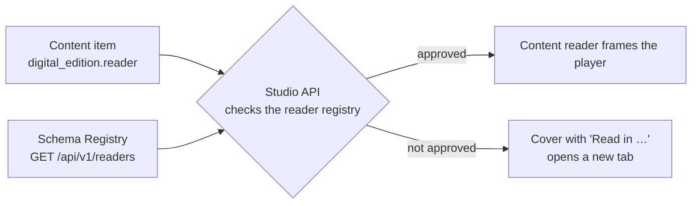

## Overview

Some content has a **digital edition** that needs a player of its own — an interactive graphic novel with panels, sound, voices and branching paths, for example. roadbeat does not rebuild such players. The content reader shows the edition in the **registered reader** for its format instead, inside a frame whose address, sandbox and permissions Studio has checked on the server.

Today one reader is registered: **PanelWave**, the open-source (MIT) player for interactive graphic novels, for the content types `comic-release` and `comic-series`.



The standalone Web Client applies the same registry and the same rules.

## What readers see

### Teaser cards

Every Discover card variant (feed, lists, tiles, masonry) shows:

| Element | Shown when | Text |
|---|---|---|
| **Interactive** badge | The edition is an interactive player (`reader_kind: interactive_player`) | Interactive |
| Access chip | The item has a digital edition | Free · Free preview · Subscription · Rent, followed by the lowest price when known ("Free preview · €4.99"). A purchase shows its price alone ("€4.99"), or "Paid" without one |
| AI chip | The publisher declared its AI use | No AI · AI-assisted · AI-generated |

The values come from the teaser's type filters on the Discovery Node: `reader_kind`, `edition_access` (for items with an edition, the teaser's access is used when it is missing; `freemium` counts as a free preview) and `ai_disclosure`. All texts are translated into the 24 EU languages.

### In the content reader

- The **player replaces the hero image**. The cover is shown as a placeholder until the player is ready.
- The player opens the **edition in the UI language** when there is one, and follows the light or dark theme. Changes of language, theme or analytics consent reach the running player without reloading it.
- **Open in a new tab** links to the reader's own page.
- Below the player, the reader lists **series, credits, age rating, AI use and the edition languages**.

The reader falls back to the cover and a **Read in PanelWave** link (new tab) when:

- the edition is not approved (see [How Studio decides](#how-studio-decides-what-to-frame)),
- the player reports an error before it is ready,
- the reader speaks another embed protocol than the PanelWave one,
- or the reader has switched off external readers in the privacy settings.

## Privacy

<Callout kind="info">
  An interactive edition is loaded from the reader's own server (for example `read.panelwave.org`) or from a Content Pod's bundle origin, never from roadbeat. No script of the reader is loaded into roadbeat itself: the frame is created by PanelWave's host SDK, which ships with Studio.
</Callout>

- **Sandbox and permissions** come from the registry entry, reduced to an allow-list. Allowed sandbox tokens: `allow-scripts`, `allow-same-origin`, `allow-popups`, `allow-popups-to-escape-sandbox`, `allow-forms`, `allow-presentation` — never top navigation. Allowed permissions: `autoplay`, `fullscreen`, `picture-in-picture`, `encrypted-media`, `screen-wake-lock` — no camera, microphone, location or payment.
- **Reading statistics only with consent.** A reader with the tracking rule `host_consent` counts reads only while the reader has given roadbeat **analytics consent** (*Discover Settings › Privacy*). The reader shows "Reading statistics only with your analytics consent" next to the player.
- **No autoplay.** The player is always started with `autoplay=0`.
- **Purchases** follow the registry's rule per platform: in place on the web, as a link out on Android, hidden on iOS (PanelWave's entry).
- **Switch it off.** *Discover Settings › Privacy › Load interactive content from external readers* (on by default, kept per account in this browser). When it is off, interactive editions open in a new tab.

`GET /api/v1/consumer/discover/readers` lists every registered reader with the origins it is framed from, the hosts it contacts (`thirdPartyRequests`) and its privacy policy (`policyUrl`).

## How Studio decides what to frame

The client never frames an address the Studio API did not approve. For each item, the API:

<Steps>
  <Step title="Finds the registry entry">
    The item's `digital_edition.reader` names a `kind` and a `format`. A registry entry must list the item's content type, that reader kind and that format. If the item names an `embed_protocol`, it must belong to the same protocol family as the entry's (`panelwave-embed/…`).
  </Step>
  <Step title="Checks the address">
    The frame address is `embed_url`, else `reader_url`. It must be `https`, carry no user name or password, and lie on one of the entry's registered origins — or on a Content Pod bundle origin (`POD_BUNDLE_DOMAIN_PATTERNS`, default `*--b.pods.roadbeat.net`) when the entry allows pod bundles.
  </Step>
  <Step title="Checks the language editions">
    Each entry of `editions` keeps its reader address only if that address passes the same check.
  </Step>
</Steps>

If no entry matches or the address fails, the response carries `externalReader: null` and the reader shows the cover and the item's own links.

<Expandable title="Example: a self-hosted edition" default-open="false">
  A `comic-release` from the Schema Registry examples, shortened:

  ```json
  {
    "digital_edition": {
      "reader": {
        "kind": "interactive_player",
        "name": "PanelWave",
        "format": "panelwave",
        "reader_url": "https://comics.example.org/the-lighthouse-keeper/read/",
        "embed_url": "https://comics.example.org/the-lighthouse-keeper/read/?embed=1",
        "embed_protocol": "panelwave-embed/4"
      },
      "features": ["branching", "choices", "audio", "voice", "panel_view", "page_view"],
      "editions": [
        { "language": "de", "locale": "de-DE", "reader_url": "https://comics.example.org/the-lighthouse-keeper/read/?lang=de-DE", "translation": "original" },
        { "language": "en", "locale": "en-US", "reader_url": "https://comics.example.org/the-lighthouse-keeper/read/?lang=en-US", "translation": "human" }
      ],
      "access": {
        "model": "free_preview",
        "is_free": false,
        "offers": [{ "type": "purchase", "price": { "amount": 4.99, "currency": "EUR" } }]
      }
    },
    "ai_disclosure": { "level": "assisted" },
    "content_rating": { "rating": "teen" }
  }
  ```

  The entry for PanelWave matches (`comic-release`, `interactive_player`, `panelwave`, protocol `panelwave-embed/4`). But `comics.example.org` is neither PanelWave's registered origin (`https://read.panelwave.org`) nor a pod bundle origin, so the edition is **not framed**: the reader shows the cover with **Read in PanelWave**. Hosted on `read.panelwave.org` or as a [Content Pod bundle](#hosting-on-your-content-pod), the same edition plays inside roadbeat.

  The card shows **Interactive**, **Free preview · €4.99** and **AI-assisted**.
</Expandable>

## The reader registry

Readers are registered in the **Schema Registry** (`GET /api/v1/readers`), one signed entry per reader, the same way content type schemas are published.

| Entry field | Meaning |
|---|---|
| `content_types` | Content types the reader is used for |
| `match.reader_kind`, `match.format` | Values of `digital_edition.reader.kind` and `.format` it plays |
| `frame.origins` | Origins the player may be framed from |
| `frame.allow_pod_bundles` | Whether it may also be framed from Content Pod bundle origins |
| `frame.bundle_signature_keys` | Where its signing keys are published (for [pod bundles](/guides/integration-api#content-pod-bundles)) |
| `frame.protocol` | Embed protocol (`panelwave-embed/4`) |
| `frame.sandbox`, `frame.allow` | Requested sandbox tokens and permissions (reduced to the allow-lists above) |
| `privacy` | Tracking rule, hosts it contacts, privacy policy |
| `purchase_ui` | Purchase UI per platform: `in_place`, `link_out` or `hidden` |

Studio keeps the list for an hour. With `SCHEMA_REGISTRY_VERIFY_SIGNATURES=true` each entry's Ed25519 signature is checked with the same key and canonical form as the schemas. When the registry cannot be reached, or nothing in its answer verifies, Studio uses a bundled copy of the list (PanelWave) and asks the registry again after five minutes.

## Preview in the editor

Layouts of the comic types contain an `embed` region. In the editor's [layout preview](/editors/content-editor#layout-preview) it shows the same player as the content reader while you edit, once the reader registry approves the item's `digital_edition` (`POST /api/v1/consumer/discover/readers/approve`). The check runs once per changed reader value, not on every keystroke.

If the edition is not approved, the region shows the cover with a **Read** link and the reason: *"Shown as a link: this address is not on a registered reader."*

## Hosting on your Content Pod

A reader that allows pod bundles (PanelWave does) can place a **signed package** of an edition on the organization's Content Pod through the [Integration API](/guides/integration-api#content-pod-bundles). The pod serves it from its own bundle origin, `https://{subdomain}--b.pods.roadbeat.net/{bundleId}/`, which the reader registry accepts as a frame address. Organizations with their own storage add a bundle origin of their own in the pod dashboard's [Storage tab](/guides/content-pod#storage-tab).

## Configuration

| Variable | Default | Description |
|---|---|---|
| `SCHEMA_REGISTRY_VERIFY_SIGNATURES` | `false` | Check the Ed25519 signatures of reader entries (and schemas) from the Schema Registry, with the public key in `SCHEMA_REGISTRY_PUBLIC_KEY` |
| `POD_BUNDLE_DOMAIN_PATTERNS` | `*--b.pods.roadbeat.net` | Hosts of Content Pod bundle origins readers may be framed from, comma-separated |
| `EXTERNAL_READER_DEV_ORIGINS` | — | Extra frame origins for local development, e.g. `http://localhost:4300` for a local PanelWave reader. Ignored when `NODE_ENV=production` |

## API

| Endpoint | Does |
|---|---|
| `GET /api/v1/consumer/discover/readers` | The registered readers: origins, protocol, tracking rule, third-party hosts, privacy policy |
| `POST /api/v1/consumer/discover/readers/approve` | Checks an edited item (`contentType`, `item` with at least `digital_edition`) and returns the approved reader or `null` |
| `GET /api/v1/consumer/discover/content/{contentType}/{slug}` | The reader content; carries `externalReader` with the approved frame address, sandbox, permissions, editions, features and access |

Teasers in search responses carry `readerKind`, `editionAccess` (`model`, `minPrice`, `currency`) and `aiUse`. See the consumer area of the API reference for the full schemas.
