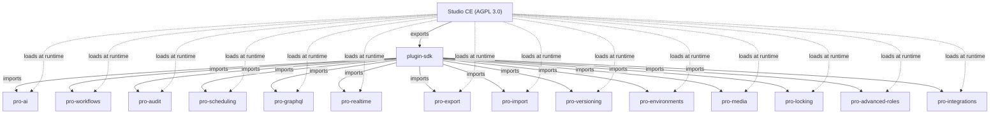

## Overview

roadbeat Studio uses a **plugin architecture** to separate Community Edition (CE) features from Pro features. CE defines well-documented extension points; Pro features are developed as separate plugin packages that are loaded at runtime.



**Key principles:**

- CE **never** imports Pro code
- Pro plugins import **only** from `@roadbeat/plugin-sdk`
- Plugins are loaded dynamically at runtime from the `PLUGINS_DIR` directory
- Each plugin is a self-contained NestJS module
- License validation is offline (no phone-home) via Ed25519 signed JWT
- All plugin data is **org-scoped** — plugin tables include `organization_id`, queries filter by org, and event handlers verify `organizationId` before acting

## How It Works

<Steps>
  <Step title="Plugin Discovery" icon="search">
    On startup, Studio scans the `PLUGINS_DIR` directory for plugin packages. Each plugin must have a `manifest.json` and an entry point file.
  </Step>
  <Step title="Database Migrations" icon="database">
    The SQL migrations of the discovered plugins are applied before Nest initializes any plugin module — see [Plugin database migrations](#plugin-database-migrations).
  </Step>
  <Step title="License Validation" icon="key">
    The `ROADBEAT_LICENSE_KEY` environment variable is validated offline using an Ed25519 public key embedded in CE. The license token specifies which plugins are allowed.
  </Step>
  <Step title="Module Registration" icon="plug">
    Licensed plugins have their NestJS modules registered dynamically into the application. Controllers, services, and event handlers become available.
  </Step>
  <Step title="Frontend Loading" icon="monitor">
    Plugin frontend bundles are served as **web components** via `@angular/elements`. The CE admin UI loads them dynamically based on the plugin manifest.
  </Step>
</Steps>

## Extension Points

Plugins can extend Studio in several ways:

| Extension | Description |
|-----------|-------------|
| **NestJS Module** | Register controllers, services, and providers |
| **Admin Routes** | Add pages to the admin UI |
| **Menu Items** | Add entries (localized labels, groups, sort order) to the sidebar navigation |
| **Editor Extensions** | Add sidebar panels to the content editor |
| **Dashboard Widgets** | Add widgets to the dashboard |
| **Event Handlers** | Listen to CE lifecycle events |
| **Database Tables** | Add tables via migration SQL files, applied by the host at startup |
| **Shared Services** | Inject host services by token — e.g. `CONTENT_SERVICE`, or `CONTENT_SHAPE_SERVICE` to bring stored content data into a type's storage shape |

## Available Pro Plugins

Pro plugins are documented in the [Studio Pro documentation](https://studio-pro-docs.roadbeat.net/introduction).

| Plugin | Description |
|--------|-------------|
| **pro-ai** | AI Assistant & Provider Gateway — governed local + cloud AI (chat, translation, writing, embeddings, vision, schema-grounded generation) |
| **pro-workflows** | Editorial workflows with multi-stage approval, tasks |
| **pro-scheduling** | Scheduled publish/unpublish, releases |
| **pro-locking** | Pessimistic content locking with heartbeat |
| **pro-preview** | Secure preview tokens and shareable, password-protected URLs |
| **pro-import** | CSV/JSON import with field mapping and transforms |
| **pro-export** | Advanced CSV/JSON export with templates and transforms |
| **pro-versioning** | Side-by-side version comparison with field-level diffs |
| **pro-layouts** | Custom layout builder with versioning, import/export, Git sync |
| **pro-saved-views** | Save and share filtered content views with custom columns |
| **pro-advanced-roles** | Per-content-type permissions, custom roles |
| **pro-sso** | SSO via SAML 2.0, OAuth 2.0/OIDC, SCIM provisioning |
| **pro-audit** | Full audit trail, compliance reports, retention policies |
| **pro-graphql** | Auto-generated GraphQL API from content types |
| **pro-realtime** | WebSocket real-time updates, presence, collaborative cursors |
| **pro-webhooks** | Advanced webhooks: retry/backoff, dead-letter queue, incoming webhooks |
| **pro-notifications** | In-app + Slack/Teams/Discord notifications, preferences, digests |
| **pro-environments** | Dev/staging/production environments with content promotion |
| **pro-bulk-ops** | Bulk move, delete, tag, and download assets |
| **pro-media** | Video processing, transcoding, thumbnail generation |
| **pro-whitelabel** | Custom branding, color themes, accessibility settings |
| **pro-api-explorer** | Interactive API endpoint catalog, request execution, history |
| **pro-activitypub** | ActivityPub federation — multi-actor publishing, scheduled federation, analytics |
| **pro-integrations** | Integration Hub — connectors (3,000+ tools, OpenAPI/MCP import), versioned visual Flows, an AI Studio Agent, an encrypted credential vault, and a European governance plane |

## License System

### License Token

The license is an Ed25519-signed JWT containing:

```json
{
  "sub": "customer-uuid",
  "org": "Organization Name",
  "tier": "team",
  "features": ["pro-workflows", "pro-audit", "pro-scheduling"],
  "max_users": 15,
  "iat": 1740000000,
  "exp": 1771536000,
  "iss": "license.roadbeat.dev"
}
```

### Configuration

Set the license key in your `.env`:

```bash
ROADBEAT_LICENSE_KEY=eyJhbGciOiJFZDI1NTE5...
PLUGINS_DIR=./plugins
```

### Grace Period

If a license expires:

- **7-day grace period** — Pro features keep working, admin sees a renewal warning
- **After 7 days** — Pro features disable gracefully, CE features remain fully functional
- **Content is never locked** — all data remains accessible in CE mode

### CE Limits

Without Pro, CE enforces these defaults:

| Limit | CE Default | Pro |
|-------|-----------|-----|
| Users | 3 | Unlimited |
| Webhooks | 3 | Unlimited |
| API Keys | 2 | Unlimited |
| Content Versions | 10 per item | Unlimited |
| Storage | 5 GB | Unlimited |

## Event System

Plugins interact with CE primarily through the **event system**. CE emits lifecycle events that plugins can listen to:

### Content Events

| Event | Trigger | Preventable |
|-------|---------|-------------|
| `content.beforeCreate` | Before content is saved | Yes (can modify data) |
| `content.afterCreate` | After content is created | No |
| `content.beforeUpdate` | Before content is updated | Yes |
| `content.afterUpdate` | After content is updated | No |
| `content.beforeDelete` | Before content is deleted | Yes |
| `content.afterDelete` | After content is deleted | No |
| `content.beforePublish` | Before content is published | Yes |
| `content.afterPublish` | After content is published | No |
| `content.beforeUnpublish` | Before content is unpublished | Yes |
| `content.afterUnpublish` | After content is unpublished | No |

### Preventable Events

"Before" events can be **prevented** by plugins. For example, the `pro-workflows` plugin prevents publishing if content hasn't been approved:

```typescript
@OnEvent('content.beforePublish')
async checkApproval(event: ContentBeforePublishEvent) {
  if (!await this.isApproved(event.contentId)) {
    event.prevent('Content must be approved before publishing');
  }
}
```

When an event is prevented, CE throws a `ForbiddenException` with the prevention reason.

## Plugin Database Migrations

Plugins ship their tables as plain SQL files (`migrations/*.sql` in each plugin, plus the shared `packages/plugin-base/migrations`). The Studio API applies them itself — there is no separate migration command to run:

1. On startup, after plugin discovery and **before** Nest initializes any plugin module, the API applies the **plugin-base** migrations first, then each discovered plugin's files in file-name order.
2. Every applied file is recorded in the `plugin_migrations` table (`plugin`, `name`, `checksum`, `skipped_statements`, `applied_at`). Recorded files are not run again.
3. Each file runs in **one transaction**, statement by statement with a savepoint per statement. An "already exists" error (or "does not exist" for a `DROP`) means that part was applied earlier — for example on an install that predates the runner — and is skipped, so existing installations are baselined automatically.
4. Any other error rolls the whole file back, records nothing, and skips that plugin's later migrations. The API still starts; the failure is logged.
5. A file whose content changed after it was applied is **reported, not re-run** — ship a new migration file instead of editing an applied one.

| Variable | Default | Description |
|----------|---------|-------------|
| `PLUGIN_MIGRATIONS` | on | `off` skips the step (e.g. when a deploy step applies the files) |
| `PLUGIN_BASE_MIGRATIONS_DIR` | `<PLUGINS_DIR>/../packages/plugin-base/migrations` | Where the plugin-base migrations live |

<Callout kind="info">
  Before this runner existed, plugin tables had to be created by hand and a missing one only surfaced at runtime (for example, every content export failed). Upgrading needs no action — existing tables are detected and the files are recorded as applied.
</Callout>

## Plugin Manifest

The plugin manifest at `GET /api/v1/plugins/manifest` exposes loaded plugin information to the frontend (abridged):

```json
{
  "data": {
    "edition": "pro",
    "tier": "team",
    "activePluginIds": ["pro-workflows", "pro-audit"],
    "plugins": [
      {
        "id": "pro-workflows",
        "name": "Editorial Workflows",
        "version": "0.1.0",
        "active": true,
        "adminRoutes": [{ "path": "workflows", "label": { "en": "Workflows", "de": "Workflows" }, "order": 100 }],
        "menuItems": [
          {
            "section": "content",
            "group": "editorial",
            "label": { "en": "Workflows", "de": "Workflows" },
            "icon": "git-branch",
            "route": "/workflows",
            "order": 10
          }
        ],
        "menuGroups": [{ "id": "editorial", "label": { "en": "Editorial" }, "order": 20 }],
        "editorExtensions": [{ "id": "workflow-status", "type": "sidebar-panel", "order": 100 }],
        "uiBaseUrl": "/api/v1/plugins/pro-workflows/ui",
        "dependenciesSatisfied": true
      }
    ],
    "limits": { "max_users": 15, "max_api_keys": 10, "max_webhooks": 10 }
  }
}
```

The frontend uses this to conditionally render Pro UI elements:

- **Labels are localized.** Menu groups, menu items and breadcrumbs carry a label per locale; the admin UI picks the active interface language, then its base language, then English, then the first available value.
- **Order is honored.** Every menu item, admin route and editor extension carries `order` (default `100`, lower comes first), and items are sorted by it within their section or group.
- **Nothing becomes unreachable.** A menu item without a group — or with a group no active plugin defines — is listed in a built-in **More** group instead of being hidden.

## Errors from Plugins

Plugin endpoints answer with the same [error body](/api-reference/overview#error-responses) as CE endpoints, including a stable `code` (see [Error Codes](/api-reference/error-codes)). Plugins are built against their own copy of `@nestjs/common`, so their exception classes are not the host's — the host's exception filter recognizes any HTTP exception by its shape, so a plugin's `404`, `403` or `409` reaches the client with its real status instead of a generic `500`.
